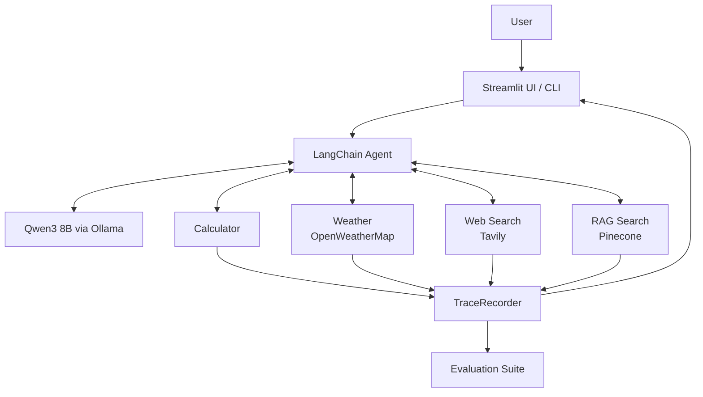
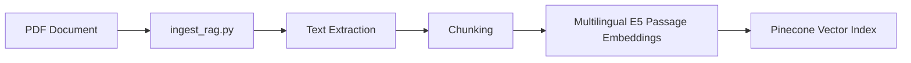

# Multitool Research & Knowledge Agent

A local AI research and knowledge agent built with **Qwen3**, **Ollama**, and **LangChain**. It orchestrates multiple tools for calculations, live weather, web search, and private-document retrieval using Retrieval-Augmented Generation (RAG).

The project includes a Streamlit interface, execution tracing, an evaluation suite, and Docker support.

## Key Features

- **Tool orchestration:** Uses Qwen3 through LangChain to select and execute one or multiple tools.
- **Calculator:** Safe arithmetic evaluation.
- **Weather:** Current weather information through OpenWeatherMap.
- **Web search:** Public and current information through Tavily.
- **Private-document RAG:** Multilingual E5 embeddings, Pinecone vector retrieval, and BGE reranking.
- **Document upload:** Upload a PDF through the Streamlit interface and query its content.
- **Observability:** Records tool calls, arguments, execution status, latency, output previews, and errors.
- **Evaluation:** A 60-case test suite covering tool selection, execution, answer assertions, multitool requests, edge cases, and safety scenarios.
- **Docker:** Containerized Streamlit application with Docker Compose.

## Architecture



## Tools

| Tool | Purpose |
|---|---|
| `calculator` | Arithmetic evaluation, exponents capped at 100 |
| `get_weather` | Current weather via OpenWeatherMap |
| `web_search` | Public web search via Tavily |
| `rag_search` | Private knowledge retrieval from Pinecone |

The agent can select and execute multiple tools for a single request.

## RAG Pipeline

The RAG system consists of offline document ingestion and runtime retrieval.

### 1. Offline Ingestion



The ingestion pipeline:

1. Extracts text from a PDF.
2. Splits the extracted text into chunks.
3. Generates embeddings using multilingual E5.
4. Stores vectors and metadata in Pinecone.

Default configuration:

| Parameter | Value |
|---|---|
| Embedding model | `intfloat/multilingual-e5-base` |
| Chunk size | 300 characters |
| Chunk overlap | 50 character |

Private PDF files are excluded from Git. Documents can be uploaded through the Streamlit interface or ingested through the command line.

### 2. Runtime Retrieval and Reranking


Runtime configuration:

| Parameter | Default |
|---|---|
| Reranker | `BAAI/bge-reranker-v2-m3` |
| First-stage retrieval | Top-K = 20 |
| Final context | Top-N = 4 |

The first retrieval stage prioritizes recall by collecting candidate chunks. The BGE reranker scores these candidates against the query and selects the most relevant chunks for the final context.

`rag_search` accepts an optional `source` filter. When a document is uploaded through the UI, the agent can scope retrieval to that document.

## Observability

`TraceRecorder` stores, for each tool call: name, arguments, status, latency, an output preview, and the error if there was one. It shows what the tools did, not the model's internal reasoning.

## Evaluation

The suite has 60 cases: calculator (9), weather (8), web search (8), RAG (14), multitool (8), edge (8) and safety (5). Each case lists the tools that should be used. Tool selection is an exact match, so calling an extra tool counts as a miss. 38 cases also have answer assertions (required text, forbidden text, or a regex pattern).

```bash
python -m evaluation.evaluate
```

### Final Evaluation Results

| Metric | Result |
|---|---:|
| Tool selection accuracy | 93.33% (56/60) |
| Tool execution success | 96.67% (58/60) |
| Answer correctness | 86.84% (33/38 assertions) |
| Mean end-to-end latency | 64.58s |
| P50 end-to-end latency | 40.51s |
| P95 end-to-end latency | 228.07s |

**Interpretation:** Answer correctness is calculated only from the 38 assertions that have expected-answer checks; it is not an accuracy score over all 60 cases. The evaluation set is intended as a practical regression check rather than a statistically robust benchmark. Latency varies with model inference, retrieval, and external API calls.

## Project Structure

```text
multitool_research_agent/
├── app.py
├── agent.py
├── config.py
├── main.py
├── trace.py
├── ingest_rag.py
├── requirements.txt
├── Dockerfile
├── compose.yaml
├── .dockerignore
├── .gitignore
├── .env.example
├── tools/
│   ├── __init__.py
│   ├── calculator.py
│   ├── weather.py
│   ├── web_search.py
│   └── rag.py
├── evaluation/
│   ├── dataset.json
│   └── evaluate.py
└── data/
    └── documents/
        └── README.md
```

## Requirements

- Python 3.11 for local execution
- Ollama with the `qwen3:8b` model
- API keys for OpenWeatherMap, Tavily and Pinecone, plus a Pinecone index for RAG
- Docker Desktop for containerized execution

## Configuration

Copy `.env.example` to `.env` and configure the required credentials and settings.


## Run Locally

Create and activate a virtual environment:

```bash
python -m venv .venv
```

Windows PowerShell:

```powershell
.\.venv\Scripts\Activate.ps1
```

macOS/Linux:

```bash
source .venv/bin/activate
```

Install dependencies, pull the model, and start the UI (Ollama must be running):

```bash
pip install -r requirements.txt
ollama pull qwen3:8b
streamlit run app.py
```

Open `http://localhost:8501`. To use the CLI instead:

```bash
python main.py "Calculate 9 * 17"
```

To ingest a PDF:

```bash
python ingest_rag.py
python ingest_rag.py data/documents/my_document.pdf
```

Without an argument the script ingests its default document; pass a path to ingest another file. Ingest each document once.

## Run with Docker

Compose runs the Streamlit app in a container. Ollama stays on the host (the container reaches it through `host.docker.internal`), and Pinecone and the other APIs are external services.

```bash
docker compose up --build -d
docker compose ps
docker compose logs --tail 100 multitool
docker compose down
```

Open `http://localhost:8501`. The first build is slow because the embedding and reranker models are large.

## Limitations

- Tool selection and answer quality are not perfect; see the evaluation results and their limitations.
- End-to-end latency can be high, especially for model inference and RAG requests.
- The evaluation suite is a small project-level regression set, not a comprehensive scientific benchmark.
- Prompt-injection defence lives in the prompt only, web content goes into the model's context unfiltered.
- Single user, single process. One shared agent instance, not load-tested.
